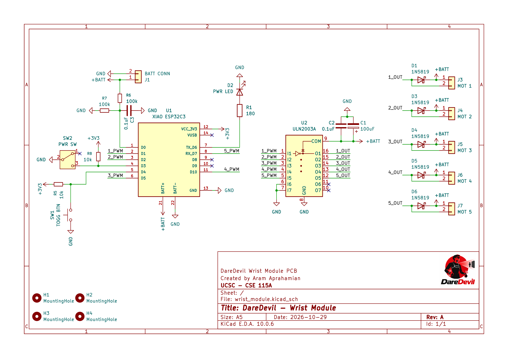
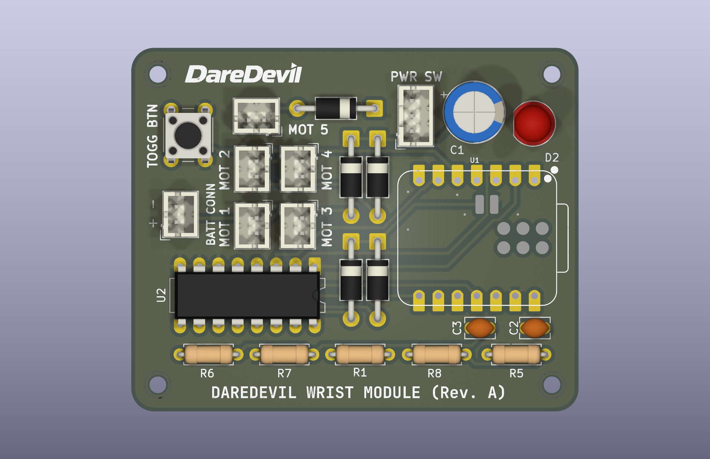
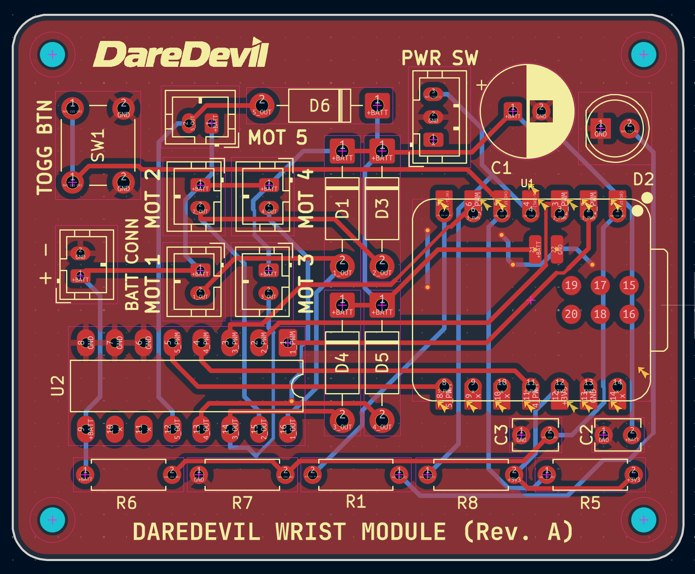

### Project Overview

A concise summary of the problem, goals, scope, and tools behind this project.

#### Problem Statement

A computer-vision based system which uses a depth camera and a set of vibration motors along each wrist to identify obstacles and help the visually impaired avoid physical dangers.

This project will utilize an Intel RealSense Depth Camera, NVIDIA Jetson Orin Nano, ESP32 microcontrollers, small vibration motors, and Batteries for its hardware. Software will be developed to utilize the camera system to identify obstacles. Vibration motors will change intensity and pattern for giving general direction and/or identify specific dangers.


#### Project Goals

The goal by the end of class is to have a working software + hardware proof of concept that can reliably detect obstacles, provide haptic feedback to nearest obstacles, utilize variable vibration intensities, and be fully wearable.

#### Scope of Work

This will be a self-contained device. Self-powered and can be ran completely isolated.

#### Tech Stack

TBD

#### Hardware

Hardware design files live in [`hardware/`](hardware/). All PCB work is done in **KiCad 10**. See the [hardware README](hardware/README.md) for full details.

```
hardware/
+-- README.md
+-- wrist_module/                  KiCad project for the wrist haptic board
    +-- wrist_module.kicad_pro     Project file (open this in KiCad)
    +-- wrist_module.kicad_sch     Schematic
    +-- wrist_module.kicad_pcb     PCB layout
    +-- wrist_module.kicad_prl     Local KiCad UI settings (per user)
    +-- Prints/                    Exported schematic and board renders
    |   +-- wrist_module.pdf       Schematic (PDF)
    |   +-- wrist_schematic.png    Schematic (PNG, made from the PDF)
    |   +-- wrist_module.png       Front render
    |   +-- pcb_traces.png         PCB layout showing copper traces
    |   +-- wrist_module_back.png  Back render
    +-- Library/                   Third-party symbols and footprints
        +-- 113991054/             Seeed XIAO ESP32C3 symbol, footprint, and 3D model
        +-- OPL_Kicad_Library-master/  Seeed Open Parts Library
```

##### Wrist Module

The wrist module is a small battery-powered board worn on each wrist. It drives up to five vibration motors that signal the direction and type of nearby obstacles.

| Schematic | PCB (front) | PCB (traces) |
| --- | --- | --- |
|  |  |  |

| Part | Purpose |
| --- | --- |
| Seeed XIAO ESP32-C3 | Microcontroller; controls motor intensity and patterns |
| ULN2003A | Darlington driver array that switches the motors |
| 5 x motor connectors (MOT 1-5) | Vibration motor outputs, each with a 1N5819 flyback diode |
| Battery connector (BATT CONN) | Battery power input |
| PWR SW (SPDT) | Main power switch |
| TOGG BTN | User push button |
| PWR LED | Power indicator |

To open the project, open `hardware/wrist_module/wrist_module.kicad_pro` in KiCad 10. If symbols or footprints show as missing, add the libraries under `hardware/wrist_module/Library/` in **Preferences -> Manage Symbol/Footprint Libraries** (as project-specific libraries).
