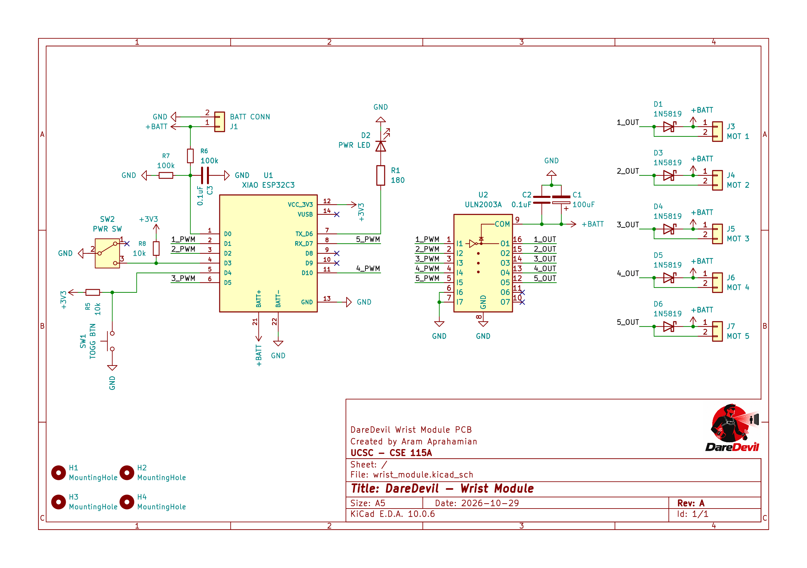
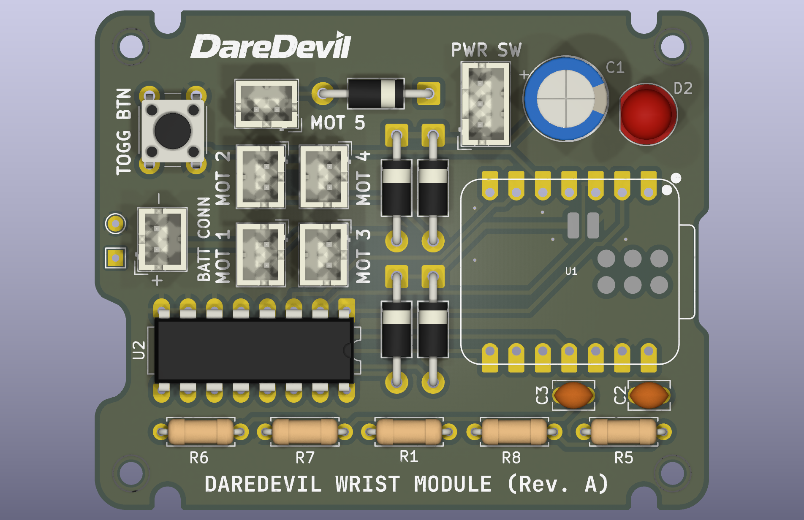
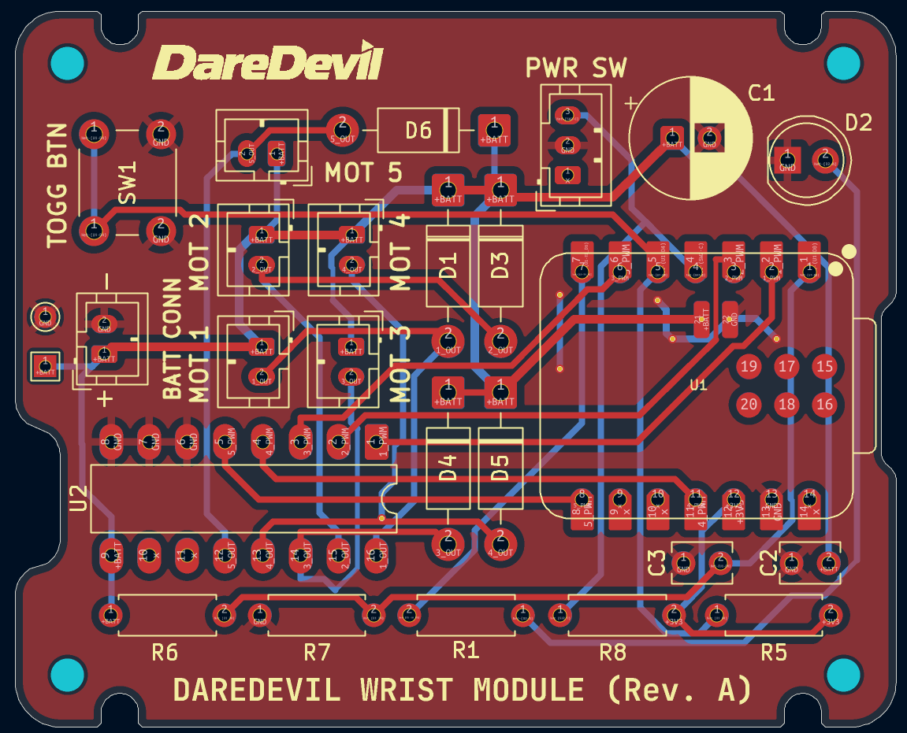

# Hardware

Hardware design files for **DareDevil**, a wearable obstacle-detection system for the visually impaired. A depth camera and an NVIDIA Jetson Orin Nano detect obstacles, and a module on each wrist gives haptic feedback through vibration motors. See the [project README](../README.md) for the full overview.

All PCB work here is done in **KiCad 10**. Enclosures are modeled in **Autodesk Fusion** and exported for 3D printing.

**Author:** Aram Aprahamian ([aapraham@ucsc.edu](mailto:aapraham@ucsc.edu))

## Directory layout

```
hardware/
├── README.md
├── models/                        3D models for enclosures
│   └── Wrist Module/
│       ├── Wrist_Module_Enclosure.f3z    Fusion archive (editable source)
│       ├── Wrist Module Enclosure.3mf    Print-ready model (open in a slicer)
│       ├── enclosure.png                 Assembled render
│       └── enclosure_exploded.png        Exploded render
└── wrist_module/                  KiCad project for the wrist haptic board
    ├── wrist_module.kicad_pro     Project file (open this in KiCad)
    ├── wrist_module.kicad_sch     Schematic
    ├── wrist_module.kicad_pcb     PCB layout
    ├── wrist_module.kicad_prl     Local KiCad UI settings (per user)
    ├── Prints/                    Exported schematic and board renders
    │   ├── wrist_module.pdf       Schematic (PDF)
    │   ├── wrist_schematic.png    Schematic (PNG, made from the PDF)
    │   ├── wrist_module.png       Front render
    │   ├── pcb_traces.png         PCB layout showing copper traces
    │   └── wrist_module_back.png  Back render
    ├── Library/                   Third-party symbols and footprints
    │   ├── 113991054/             Seeed XIAO ESP32C3 symbol, footprint, and 3D model
    │   └── OPL_Kicad_Library-master/  Seeed Open Parts Library
```

## wrist_module

The wrist module is a small battery-powered board worn on each wrist. It drives up to five vibration motors that signal the direction and type of nearby obstacles.

| Schematic | PCB (front) | PCB (traces) |
| --- | --- | --- |
|  |  |  |

Main parts:

| Part | Purpose |
| --- | --- |
| Seeed XIAO ESP32-C3 | Microcontroller; controls motor intensity and patterns |
| ULN2003A | Darlington driver array that switches the motors |
| 5 x motor connectors (MOT 1–5) | Vibration motor outputs, each with a 1N5819 flyback diode |
| Battery connector (BATT CONN) | Battery power input |
| PWR SW (SPDT) | Main power switch |
| TOGG BTN | User push button |
| PWR LED | Power indicator |

### Enclosure

The board sits in a two-part 3D-printed enclosure: an open base and a flat lid, fastened together with four socket-head cap screws that also hold the PCB in place. The lid has openings for the push button (TOGG BTN) and the power LED, and the base has side cutouts for the board's connectors and switch.

| Assembled | Exploded |
| --- | --- |
|  |  |

- `models/Wrist Module/Wrist_Module_Enclosure.f3z`: editable source. Open it in Fusion with **File -> Open -> Open from my computer**.
- `models/Wrist Module/Wrist Module Enclosure.3mf`: print-ready model. Load it into a slicer (Bambu Studio, PrusaSlicer, Cura, etc.).

### Opening the project

1. Open `wrist_module/wrist_module.kicad_pro` in KiCad 10.
2. If symbols or footprints show as missing, add the libraries under `wrist_module/Library/` in **Preferences -> Manage Symbol/Footprint Libraries** (as project-specific libraries).

### Notes

- Everything in `Prints/` is exported from KiCad, and the enclosure renders and `.3mf` are exported from Fusion. Re-export them after changing the design so they stay current.
- To regenerate the schematic PNG from the PDF (needs ImageMagick and Ghostscript):
  `magick -density 300 wrist_module/Prints/wrist_module.pdf -background white -alpha remove -alpha off wrist_module/Prints/wrist_schematic.png`
